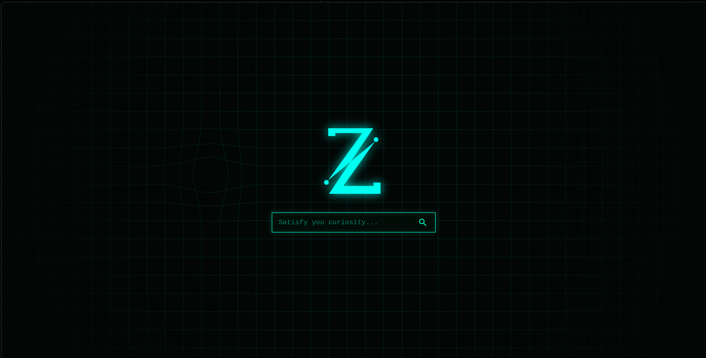

# Zetesis-the-Finder

Do you ever get annoyed by having dozens of tabs open (and your browser starting to crash) just because your *curiosity* couldn't stop asking for more?

That's why **Zetesis the Finder** was created!
*(well, is being created)*.

It is an immersive and intuitive website designed to ***satisfy your curiosity*** and give you that *flow state* you crave, all with ONE click.

You could say it's a better version of Wikipedia — you'll feel like an actual detective!

## Why should I use it?

you may ask...
And the truth is... **WHY NOT?**

It is literally inspired by all those police and detective TV shows where you'd see that cool Y2K laptop layout and how everything was connected! *C'mon you wanted that, didn't you?!*

# How to use it

[Zetesis the Finder demo](https://milyjamily.github.io/Zetesis-the-Finder/)

Is pretty simple:

> You just need to search for something and... *et voilà!* Every piece of information you want — and didn't even know you wanted — from basic details to secret files, will be right there in seconds, right in front of your eyes!

### The technical part (I guess)

[Code repository](https://github.com/MilyJamily/Zetesis-the-Finder)

I'm using pure HTML, CSS, and JS in VS Code — maybe not the easiest choice, but I'm building this from scratch while learning. This is my very first tech project, and it’s been an incredible journey so far!

*(Building this alongside Hack Club makes diving into the world of coding way easier and so much more fun :D)*

I'm learning as I build — fixing endless bugs, searching for solutions, asking for help, and going through the whole process. I almost set it aside at one point because a stubborn "X button" was driving me completely hopeless... but as always: never give up!

# Final instructions

**Zetesis the Finder** is *not meant* to harass anyone or handle sensitive personal information. It’s built purely for the sake of *curiosity*, and fake or misleading information will not be tolerated.

***Since Zetesis the Finder is still in its early stages, plenty of updates and improvements are on the way!***

I’m super open to feedback, suggestions, or help — feel free to reach out to me at *jamilylobi12@gmail.com*!

.
### AI DISCLOSURE

I use AI as a learning tool to explore HTML tags, styling, functional coding, and software development in general.

*P.S. It also helped refine my English text*
*P.P.S. GIF source: giphy.com*